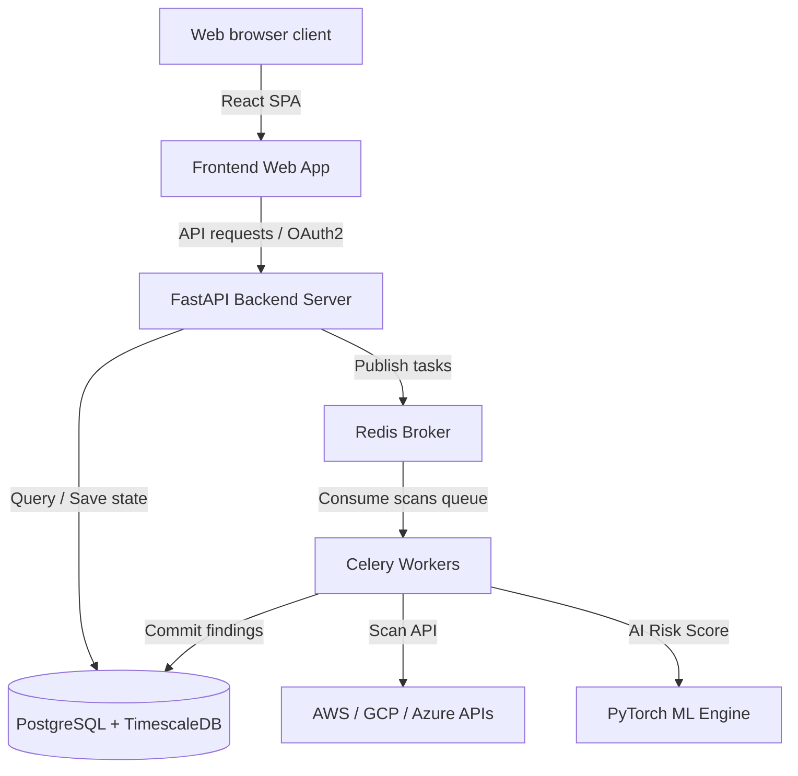

# SecureFlow - AI-Powered Cloud Security Posture Management (CSPM)

SecureFlow is a local cloud-security research prototype. It includes AWS listing/check workflows, explicit sample-data demos and review-only Terraform plans. It is not production-ready or a complete cloud compliance audit. No automatic cloud repairs are verified. Credential storage and policy/region coverage still need hardening.

---

## 🏗️ System Architecture



---

## 📂 Project Structure

```
secureflow/
├── backend/
│   ├── app/
│   │   ├── api/             # Auth, Scans, Vulnerabilities routers
│   │   ├── config/          # Settings schema & DB pooling connections
│   │   ├── core/            # JWT security, custom middleware, exceptions
│   │   ├── database/        # Declarative models for SQL Tables
│   │   ├── ml/              # PyTorch Neural Classifiers & training scripts
│   │   ├── scanners/        # Boto3 AWS (S3, EC2, IAM) scanning loops
│   │   ├── services/        # Logic handlers
│   │   ├── tasks/           # Asynchronous Celery workers
│   │   └── utils/           # JSON logger, metrics hooks
│   └── tests/               # Pytest verification suite
├── frontend/
│   ├── src/
│   │   ├── components/      # Dashboard, ScanList, VulnerabilityDetails
│   │   ├── services/        # Axios API handlers
│   │   └── App.tsx          # Material UI application base
│   └── index.html           # SPA template mount
├── scripts/
│   ├── seed_database.py     # Database configuration seeder
│   └── setup.sh             # Automated bootstrapping tool
├── docker-compose.yml       # Production-ready orchestration
└── README.md
```

---

## ⚡ Quick Start (Single-Command Setup)

To configure, compile, train the AI models, and run the database and dashboard locally:

1. **Bootstrap local setup script**:
   ```bash
   bash scripts/setup.sh
   ```

2. **Start the orchestrations container**:
   ```bash
   docker-compose up --build
   ```

3. **Verify services**:
   - Access **SecureFlow Web App**: [http://localhost:3000](http://localhost:3000)
   - Access **FastAPI API Swagger Docs**: [http://localhost:8000/api/docs](http://localhost:8000/api/docs)
   - Default login email: `admin@secureflow.io`
   - Default login password: `password123`

---

## 🧠 AI/ML Engine Models

SecureFlow uses advanced Deep Learning models (developed in PyTorch and HuggingFace Transformers) to replace static threshold classifications:

- **Vulnerability Severity Predictor**: A PyTorch Neural Network with self-attention layers that aggregates category states to predict exact CVSS threat scores (Critical, High, Medium, Low).
- **Activity Anomaly Detector**: A PyTorch Autoencoder that measures reconstruction loss on cloud logs to isolate privilege escalations or exfiltration.
- **NLP Threat Classifier**: Keyword rules or a locally trained TF-IDF backup by default. No BERT fine-tuning experiment is included or claimed. Optional transformer loading requires an explicitly enabled local checkpoint with normal/threat labels and complete weights.

## Production signing key guard

`DEBUG=False` requires a unique random `SECRET_KEY` of at least 32 characters.
The API refuses to start with its built-in demo key or a short/blank key.
Generate your own key locally (for example, `openssl rand -hex 32`); do not commit it.
This startup check does not make the application production-ready by itself.

Configuration-only regression tests (no cloud/database required):

```bash
cd backend
python -m unittest discover -s tests -p 'test_settings.py'
```

## Tenant ownership checks

Scan dispatch now requires an active cloud account belonging to the caller's
organization. Finding reads and remediation requests are also scoped through
the owning scan's organization. Worker lookups re-check the same organization
and account relationship. Cross-tenant and inactive accounts fail before task
dispatch. No database schema change is needed.

SQLite service regressions (cloud/Celery dispatch mocked):

```bash
cd backend
python -m unittest discover -s tests -p 'test_tenant_access.py'
```

These tests do not execute cloud scans or Terraform. Existing remediation status
semantics and demo-scan behavior still need separate review; an accepted request
must not be described as a verified cloud repair.

### Remediation plans are not cloud repairs

The review-plan endpoint stores a PENDING Terraform template. It does not run
Terraform, set an execution timestamp, or close the finding. A missing template
is rejected. Existing historical APPLIED/REMEDIATED rows are not rewritten by
this source change; their execution has not been independently verified.

### Scan truthfulness checkpoint

AWS demo data is now an explicit connector choice (`credentials.scan_mode =
"demo"`). Missing credentials, client setup errors and provider read failures
never switch a real AWS scan into a simulated success. Demo findings carry a
`[DEMO]` title and synthetic evidence, and the scan ends as `DEMO_COMPLETED`.
Other providers are not wired into the worker, so new non-AWS scans are rejected.
Existing stored rows have not been relabeled or migrated.

A failed resource check fails the run rather than reporting an unverified clean
result. A completed run covers only the implemented checks. Pagination,
region/account-wide coverage and policy-condition interpretation still need
review; this is not a complete compliance audit. Existing cloud credentials
remain stored as JSON in the application database without application-level
encryption. Do not connect sensitive production credentials before hardening
secret storage. No cloud scans or repairs were performed during this change.

The broker failure path no longer creates an untracked local thread. An ambiguous
queue failure leaves a failed scan record; inspect it before retrying. Findings
receive per-run database IDs so a later scan cannot move an earlier scan's
findings. Alert records now claim only the in-app channel actually implemented,
not external Slack delivery.

Regression checks (synthetic SDK clients and SQLite, no cloud calls):

```sh
cd backend
python -m unittest discover -s tests -v
cd ../frontend
npm run build
```

Optional UI checks use Playwright Core and a local Chrome installation. Install
it in a separate test workspace, start the frontend at port 8767, then set
`NODE_PATH` to that workspace's `node_modules` and run
`node tests/demo-modes.cjs`. `BASE_URL`, `CHROME_BIN` and `SCREENSHOT_DIR` can
override the defaults. All API replies in this check are synthetic; it verifies
the demo payload, disabled secret fields, status labels and mobile overflow, not
an actual AWS scan.

### AWS pagination checkpoint

The implemented S3 bucket, EC2 instance, IAM user/MFA/access-key, RDS instance,
Lambda function, VPC and VPC flow-log listings now follow their SDK continuation
tokens. Repeated or missing continuation tokens, a 1,000-page limit, and errors
on later pages fail the run instead of publishing a partial clean result. Tests
use synthetic clients and botocore Stubber only, with no AWS requests. CloudTrail
`describe_trails` has no pagination token; it remains the existing regional
check. This does not add account/region discovery, organization-wide coverage,
full policy interpretation or every AWS service. Database credentials remain
unencrypted at application level. No claim of a complete compliance audit.

### Threat-model safety checkpoint

A base BERT checkpoint can initialize a random classification head. This must not
be treated as trained security inference. Default startup no longer loads or
downloads that base model. `ENABLE_THREAT_MODEL=true` and `THREAT_MODEL_PATH`
opt in to an already-local reviewed checkpoint with exactly `{0: "normal",
1: "threat"}` labels and no missing/mismatched weights. These guards do not prove
training quality or calibration. Log responses include `method` and
`calibrated: false`; rule confidence values are heuristic, not measured accuracy.
Only load locally trusted model/pickle artifacts; this is not an artifact sandbox.

Offline model-load regressions: `python -m unittest discover -s tests -p
 'test_threat_model_safety.py' -v` from backend (numpy required). No model download
or cloud action is part of those tests.
