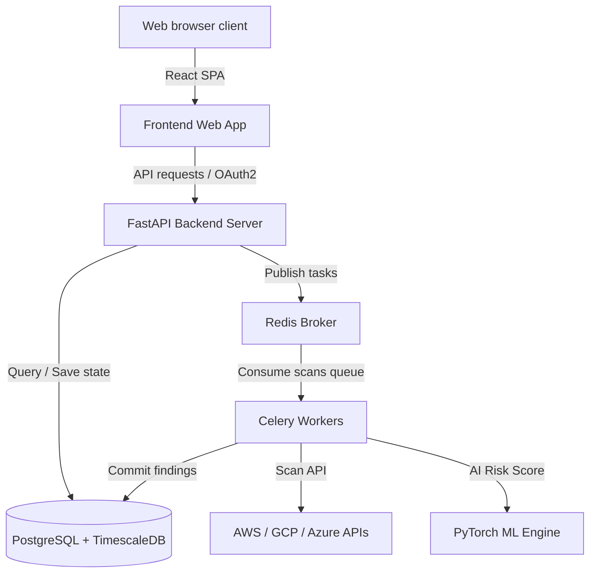

# SecureFlow — Cloud Security Posture Management (CSPM) research prototype

SecureFlow is a local cloud-security research prototype. It includes AWS listing/check workflows, explicit sample-data demos and review-only Terraform plans. It is not production-ready or a complete cloud compliance audit. No automatic cloud repairs are verified. Credential storage and policy/region coverage still need hardening.

---

## 🏗️ System Architecture



---

## 📂 Project Structure

```
secureflow/
├── backend/
│   ├── app/
│   │   ├── api/             # Auth, Scans, Vulnerabilities routers
│   │   ├── config/          # Settings schema & DB pooling connections
│   │   ├── core/            # JWT security, custom middleware, exceptions
│   │   ├── database/        # Declarative models for SQL Tables
│   │   ├── ml/              # PyTorch Neural Classifiers & training scripts
│   │   ├── scanners/        # Boto3 AWS (S3, EC2, IAM) scanning loops
│   │   ├── services/        # Logic handlers
│   │   ├── tasks/           # Asynchronous Celery workers
│   │   └── utils/           # JSON logger, metrics hooks
│   └── tests/               # Pytest verification suite
├── frontend/
│   ├── src/
│   │   ├── components/      # Dashboard, ScanList, VulnerabilityDetails
│   │   ├── services/        # Axios API handlers
│   │   └── App.tsx          # Material UI application base
│   └── index.html           # SPA template mount
├── scripts/
│   ├── seed_database.py     # Database configuration seeder
│   └── setup.sh             # Automated bootstrapping tool
├── docker-compose.yml       # Production-ready orchestration
└── README.md
```

---

## ⚡ Quick Start (Single-Command Setup)

To configure, compile, train the AI models, and run the database and dashboard locally:

1. **Bootstrap local setup script**:
   ```bash
   bash scripts/setup.sh
   ```

2. **Start the orchestrations container**:
   ```bash
   docker-compose up --build
   ```

3. **Verify services**:
   - Access **SecureFlow Web App**: [http://localhost:3000](http://localhost:3000)
   - Access **FastAPI API Swagger Docs**: [http://localhost:8000/api/docs](http://localhost:8000/api/docs)
   - To seed a local demo database, choose a password and run:
     `SEED_ADMIN_PASSWORD=<your chosen password> python scripts/seed_database.py`
   - Then sign in with `admin@secureflow.io` and the password you chose.
   - The seed never deletes existing data unless you pass `--reset` together with
     `SEED_RESET_CONFIRM=DELETE_ALL_DATA`.

---

## 🧠 AI/ML Engine Models

Runtime review rules and separate model-development code have different roles:

- **Scanner severity at runtime**: Explicit CVSS threshold review rule (Critical, High, Medium, Low), no calibrated confidence or model explanation. Separate PyTorch severity-training code is retained for experiments, not used for scanner scoring.
- **Activity Anomaly Detector**: Separate autoencoder/Isolation Forest development code. Availability and validity of local trained artifacts must be checked; an output is not proof of privilege escalation or exfiltration.
- **NLP Threat Classifier**: Keyword rules or a locally trained TF-IDF backup by default. No BERT fine-tuning experiment is included or claimed. Optional transformer loading requires an explicitly enabled local checkpoint with normal/threat labels and complete weights.

## Production signing key guard

`DEBUG=False` requires a unique random `SECRET_KEY` of at least 32 characters.
The API refuses to start with its built-in demo key or a short/blank key.
Generate your own key locally (for example, `openssl rand -hex 32`); do not commit it.
This startup check does not make the application production-ready by itself.

Configuration-only regression tests (no cloud/database required):

```bash
cd backend
python -m unittest discover -s tests -p 'test_settings.py'
```

## Tenant ownership checks

Scan dispatch now requires an active cloud account belonging to the caller's
organization. Finding reads and remediation requests are also scoped through
the owning scan's organization. Worker lookups re-check the same organization
and account relationship. Cross-tenant and inactive accounts fail before task
dispatch. No database schema change is needed.

SQLite service regressions (cloud/Celery dispatch mocked):

```bash
cd backend
python -m unittest discover -s tests -p 'test_tenant_access.py'
```

These tests do not execute cloud scans or Terraform. Remediation status
semantics were reviewed: an accepted request is a stored plan, never a verified
cloud repair. Demo-scan behavior was reviewed: demo scans end as
`DEMO_COMPLETED` and are excluded from the dashboard score, trend, forecast and
framework summary, which only read completed real scans with evaluated checks.

### Remediation plans are not cloud repairs

The review-plan endpoint stores a PENDING Terraform template. It does not run
Terraform, set an execution timestamp, or close the finding. A missing template
is rejected. Existing historical APPLIED/REMEDIATED rows are not rewritten by
this source change; their execution has not been independently verified.
Unexpected save failures return a fixed diagnostic: raw driver or database
exceptions (which can carry SQL parameters or secret-bearing URLs) never reach
the response body, and the route contract no longer describes saved plans as
executed repairs.

### Scan truthfulness checkpoint

AWS demo data is now an explicit connector choice (`credentials.scan_mode =
"demo"`). Missing credentials, client setup errors and provider read failures
never switch a real AWS scan into a simulated success. Demo findings carry a
`[DEMO]` title and synthetic evidence, and the scan ends as `DEMO_COMPLETED`.
Other providers are not wired into the worker, so new non-AWS scans are rejected.
Existing stored rows have not been relabeled or migrated.

A failed resource check fails the run rather than reporting an unverified clean
result. A completed run covers only the implemented checks. Pagination,
region/account-wide coverage and policy-condition interpretation still need
review; this is not a complete compliance audit. New real AWS credentials are stored in authenticated encrypted envelopes when
a separate storage key is configured. Legacy plaintext rows are rejected by
scan dispatch and require a deliberate secure re-registration plan. No existing
rows have been migrated. Do not connect production credentials before an
isolated end-to-end review and key-management setup. No cloud scans or repairs were performed during this change.

The broker failure path no longer creates an untracked local thread. An ambiguous
queue failure leaves a failed scan record; inspect it before retrying. Findings
receive per-run database IDs so a later scan cannot move an earlier scan's
findings. Alert records now claim only the in-app channel actually implemented,
not external Slack delivery.

### Interrupted scan recovery

Scan rows record when their current RUNNING ownership began. A soft task limit
of 29 minutes gives a stalled worker the chance to save a failed state before
the 30-minute hard kill, and a periodic sweeper marks RUNNING scans whose claim
is older than 35 minutes as FAILED, which makes them visible and reclaimable by
a later delivery. A scan a live worker may still own is never touched, and no
finding rows can exist for an interrupted run because findings commit in the
same transaction as the final status. Rows claimed before this tracking existed
fall back to their creation time. Existing databases need the new `started_at`
column added before rollout; `create_all` does not alter existing tables. The
sweeper acts only while a Celery Beat scheduler runs alongside the workers.
Recovery marks interrupted scans failed; it does not replay them, so re-dispatch
deliberately after checking effects.

Regression checks (synthetic SDK clients and SQLite, no cloud calls):

```sh
cd backend
python -m unittest discover -s tests -v
cd ../frontend
npm run build
```

Optional UI checks use Playwright Core and a local Chrome installation. Install
it in a separate test workspace, start the frontend at port 8767, then set
`NODE_PATH` to that workspace's `node_modules` and run
`node tests/demo-modes.cjs`. `BASE_URL`, `CHROME_BIN` and `SCREENSHOT_DIR` can
override the defaults. All API replies in this check are synthetic; it verifies
the demo payload, disabled secret fields, status labels and mobile overflow, not
an actual AWS scan.

### AWS pagination checkpoint

The implemented S3 bucket, EC2 instance, IAM user/MFA/access-key, RDS instance,
Lambda function, VPC and VPC flow-log listings now follow their SDK continuation
tokens. Repeated or missing continuation tokens, a 1,000-page limit, and errors
on later pages fail the run instead of publishing a partial clean result. Tests
use synthetic clients and botocore Stubber only, with no AWS requests. CloudTrail
`describe_trails` has no pagination token; it remains the existing regional
check. This does not add account/region discovery, organization-wide coverage,
full policy interpretation or every AWS service. Database credentials remain
unencrypted at application level. No claim of a complete compliance audit.

### Threat-model safety checkpoint

A base BERT checkpoint can initialize a random classification head. This must not
be treated as trained security inference. Default startup no longer loads or
downloads that base model. `ENABLE_THREAT_MODEL=true` and `THREAT_MODEL_PATH`
opt in to an already-local reviewed checkpoint with exactly `{0: "normal",
1: "threat"}` labels and no missing/mismatched weights. These guards do not prove
training quality or calibration. Log responses include `method` and
`calibrated: false`; heuristic rule flags carry no numeric confidence, and a
configured local model returns an uncalibrated score, not measured accuracy.
Only load locally trusted model/pickle artifacts; this is not an artifact sandbox.

Offline model-load regressions: `python -m unittest discover -s tests -p
 'test_threat_model_safety.py' -v` from backend (numpy required). No model download
or cloud action is part of those tests.

### Encrypted connector storage (source-only checkpoint)

New real AWS connectors require `CLOUD_CREDENTIALS_KEY`, a base64-encoded random
32-byte key, shared by API and workers and kept separately from the database.
There is no default, auto-generated fallback or plaintext write path. AES-256-GCM
authenticates the account ID, tenant ID and provider alongside the ciphertext,
so moving an envelope between accounts/tenants/providers fails verification.
Demo profiles discard all supplied keys and still work without this setting.
List/register responses never return secrets or ciphertext. Queue messages
contain only IDs, not decrypted credentials. Decryption happens just before
validation/worker use. Credentials still exist briefly in service memory and
are submitted to AWS if a real scan is separately started.

This does NOT migrate old plaintext rows, configure a deployment, rotate keys
or clear old backups. Legacy rows are intentionally blocked before queueing.
Existing operators must back up and retain their current keys, plan rotation
and secure re-registration, and review historical database/backups separately.
Do not paste keys into tickets/chat, commit them or reuse the JWT signing key.
Losing/changing the storage key makes existing envelopes unreadable. A KMS or
managed-secret integration, rotation tooling and live staging verification are
still future work. No production credential or database was touched here.

Run `python -m unittest discover -s tests -v` from `backend`. Tests use disposable
keys, synthetic credentials, SQLite and mocked scanners/dispatch only.


### Scan delivery idempotency checkpoint

Workers atomically claim only PENDING/FAILED scans and clear stale completion
metadata. Already-completed deliveries do not rescan or create duplicate results;
a RUNNING scan is not taken over by a second delivery. Three additional isolated
SQLite tests cover those boundaries. Interrupted RUNNING scans are recovered by
the sweeper described in "Interrupted scan recovery" below. This is still not a
complete broker exactly-once protocol, and distributed PostgreSQL/Celery
concurrency still needs staging validation.


### Ambiguous scan dispatch

A broker publish exception no longer marks a scan FAILED: acceptance may already
have happened, and a fast worker may already be RUNNING or completed. The API
returns503 with QUEUE_ACCEPTANCE_UNKNOWN and the owned scan ID, preserving the
record for status inspection instead of spawning a fallback or dispatching again.
Synthetic service/route tests cover a lost publish response after completion.
This does not prove broker acceptance or implement a durable outbox; PENDING
records after ambiguity still need operator reconciliation before retrying.


### Severity output provenance

Scanner severity now uses an explicit CVSS threshold review rule. The service no
longer supplies fabricated exploitability, impact, age, previous-vulnerability,
framework or region features to a model, and no longer presents static weights
as model feature importance. Response evidence names the rule, has no confidence
estimate, marks calibration false and leaves unavailable explanations empty.
Two isolated regressions cover thresholds and invalid scores. These are not
verified exploitability predictions or proof of a security incident. The separate
model-training code is retained but is not used to override scanner severity.


### Unavailable anomaly detection

The metric-analysis service returns an explicit unavailable/error response when
local detector artifacts are absent, not a fabricated normal score of0.02. Inputs
must have eight finite values and detector outputs must be finite before being
returned. Two isolated tests cover availability and numeric boundaries. Valid
output remains uncalibrated and is not a verified incident assessment.


### Explicit database selection

The backend honors `DATABASE_URL` without a startup network probe or automatic
SQLite substitution. A configured PostgreSQL outage must surface as a database
error, not an apparently empty workspace in a different local database. For an
intentional local SQLite demo, set `DATABASE_URL=sqlite:///./secureflow.db`
explicitly. Three isolated configuration tests stub engine creation; they do not
verify a live PostgreSQL server or apply migrations.

### Readiness and API contract checkpoint

The readiness probe now runs its database check with SQLAlchemy 2.0 textual SQL
and answers 200 only when the database actually responds. A failed probe returns
a fixed "not ready" body and log line: driver errors, which can carry the
database user, host or DSN, stay out of both because the probe is
unauthenticated. The API description no longer advertises "AI-powered"
management; it describes the prototype as it is. Health/readiness behavior is
covered by isolated tests with a synthetic broken database; no live database was
used.

### Registration role assignment

The server now assigns the founder role when a registration creates a new
organization; a client-supplied role is ignored. Stored roles feed RBAC checks,
so accepting them from the request would let any registrant self-assign
privilege. Registration failures return and log fixed diagnostics without raw
driver details. Isolated SQLite tests cover role assignment, duplicate handling,
token shape and failure privacy. No RBAC endpoint currently restricts by role;
this change removes the latent escalation before one does.

### Organization user directory shows real accounts

The settings directory no longer renders hardcoded sample members. A new
GET /api/v1/users endpoint returns only users of the caller's organization
(never password material), and the page loads it with loading, error and empty
states; invitations remain disabled because that flow does not exist yet.
Synthetic-API browser checks at 320/390/1280px confirm real rows, no sample
members and no document overflow; the table scrolls inside its container on
narrow screens.

### Runtime wiring disclosure

The repository still contains modules that are not wired into the running
application: `app/remediation/auto_remediate.py`, the email/Teams notifiers,
the `ml_tasks` retraining jobs and the legacy `app/ml_engine` tree. Nothing imports or schedules them; saved plans,
in-app alert records and frozen model artifacts are the real behavior. Treat
those modules as dormant references, not active capabilities. The analytics
route contracts now describe heuristic review and optional local models instead
of claiming applied NLP or autoencoder detection.

### Dashboard UX
- The dashboard shows a compliance overview with per-framework progress bars (CIS, NIST, PCI DSS, HIPAA, GDPR) from `GET /api/v1/compliance/summary`, and the top five critical/high findings by CVSS with a link to the findings page. Both sections show an honest empty state when there is nothing to show — no invented scores.
- The vulnerabilities page is a searchable, filterable list (severity pills with counts, open/remediated status, text search across title, resource and type). Selecting a finding opens a slide-over drawer with numbered remediation steps derived from the recommendation, compliance frameworks, a copyable Terraform fix, and the review-only "Save plan for review" action. Escape, backdrop click, or the close button dismisses it.

## 🧪 Running tests

Backend (uses the project's virtualenv; no live database or cloud needed):

```bash
cd backend
.venv/bin/python -m pytest tests -q
```

Frontend build (also type-checks; route pages are lazy-loaded, so the
initial bundle is the login shell plus shared chunks):

```bash
cd frontend
npm run build
```

Known state: the backend suite's one pre-existing failure,
`test_readiness_reports_ready_with_a_working_database`, is FIXED in 1.0.1
(the test harness evicted `sys.modules` entries mid-import; the fix keeps
only the intended router swap). The suite is 172 passed, 0 failed with a
live PostgreSQL instance (149 in 1.0.2, plus 4 refresh-token tests and
7 analysis-endpoint tests added in 1.0.3, plus 2 tests added in 1.0.4,
plus 10 tests added in 1.0.5) —
without a live database, that single readiness test still fails by design,
since it tests readiness *with a working database*.
Timestamps are naive UTC by design (all `DateTime` columns are
timezone-naive); `backend/app/utils/timestamps.py` is the single place that
produces them, after the deprecated `datetime.utcnow()` was removed.

## Changelog

### 1.0.5 (21 Nov 2026)
- Patch release. **Premium UI pass + senior logic review.**
- Logic: demo scans are finished scans now — `GET /compliance/summary`,
  the pass-rate history behind the forecast, and the dashboard's
  compliance score and trend chart all ignored `DEMO_COMPLETED` scans,
  so after a demo scan (the main way the app is tried) the dashboard
  showed empty states even though checks had been evaluated. All three
  now count `COMPLETED` and `DEMO_COMPLETED`; failed scans still earn
  nothing. Registration hardening: passwords must be at least 12
  characters (the seed script's bar — the public endpoint used to accept
  a one-character password) and a blank/whitespace-only organization
  name is rejected with 422. A duplicate registration that loses a race
  now returns 400 like the pre-check instead of a generic 500 (the
  unique constraint is caught as `IntegrityError` at commit).
- Logic: `GET /compliance/checks` and `GET /remediation/history` were
  the last unbounded list endpoints — both now take the same `skip` /
  `limit` (default 50, max 200) contract as the scan and finding lists.
  `declarative_base` is imported from `sqlalchemy.orm`, clearing the
  `MovedIn20Warning` the suite used to emit (suite warnings 8 → 2, both
  third-party). The stale `CloudAccount.credentials` comment claiming
  credentials are not encrypted is corrected — they are sealed AES-GCM
  envelopes.
- UI: the scan modal only offers *active* cloud accounts — inactive
  ones used to appear as choices and then fail with 400 on submit — and
  shows a hint when no active account exists. The dashboard's "finished
  scans" wording replaces "completed scans" where demo scans now count,
  and the trend chart's right margin is widened so the last date tick no
  longer renders clipped. The seed script's scan counts now agree with
  the rows it inserts (7 findings, 7 failed, 0 passed — they read 3/3/12
  while inserting 7 findings and 7 failed checks, so the scans page,
  findings page and compliance overview disagreed about one seeded scan).
- Docker: backend build not retried — still environmentally blocked in
  this VM (overlayfs mount error + Docker Hub EOF through the sandbox
  egress proxy, never reaching any repo layer), as established in
  round 7.

### 1.0.4 (21 Nov 2026)
- Patch release. **Premium UI/UX pass + senior logic review.**
- UI: signed-in users are never shown the login form again — `/login`
  redirects to the dashboard when a token exists, and unknown routes send
  signed-in users to the dashboard instead of `/login`. Login labels are
  wired to their inputs and the scan-modal account select has a labelled
  control (screen-reader/keyboard polish). Removed dead code: the
  orphaned `frontend/src/components/common/{Layout,Sidebar,Header}.tsx`
  (nothing imported them; `App.tsx` ships its own navigation header) —
  deleted with a real `git rm`, so the next push removes them from the
  remote too.
- UI (from a real headless render of the live app): the finding drawer
  slid *under* the sticky navigation header (z-index 61 vs 100), so its
  title was clipped — overlay and drawer now sit at 200/201. Dashboard
  charts no longer animate in: on a theme toggle recharts re-mounted and
  the 1.5s grow-in left the severity chart visibly empty for seconds;
  bars and trend now render instantly.
- Logic: the FastAPI app version is now read from `settings.VERSION`
  (single source of truth, pinned by a test) instead of a second hardcoded
  literal. Cloud-account registration rejects blank/whitespace-only names
  and names over the 100-char column as 400s — the first used to be stored
  as `""`, the second failed at commit time as a 500. All seven Pydantic
  `class Config` blocks migrate to `model_config = ConfigDict(...)` /
  `SettingsConfigDict` (six schemas plus `Settings` itself), clearing the
  Pydantic v2 deprecation warnings the suite used to emit (v3 will remove
  class-based config).
  Round-6 fixes re-verified still holding: `POST /auth/refresh`,
  authenticated analysis endpoints, 400s for bad payloads, logout keeping
  theme/notification preferences.
- Docker: backend build retried in this VM — still fails, environmental,
  not a repo problem (see below).

### 1.0.3 (21 Nov 2026)
- Patch release. **Premium UI pass + senior logic review.**
- UI: design-token layer (radius/easing/focus-ring tokens, global
  `:focus-visible` ring, selection colour, refined scrollbar, lift/row/
  live-dot/shimmer utilities); MUI theme gains Switch, Alert, TableRow
  hover, Tooltip and disabled-button styling; dashboard stat cards lift
  on hover and findings rows keep a selected state; the finding drawer
  has a sticky glass header and an animated CVSS gauge; scans show a
  breathing RUNNING dot, shimmering progress and a spring-animated
  trigger modal; notifications rebuilt on the Nexus glass system.
- Logic: `POST /auth/refresh` added — refresh tokens were minted but had
  no exchange endpoint, so sessions died after 30 minutes; the frontend
  now retries once on 401 via a refresh interceptor. The two analysis
  endpoints (`/vulnerabilities/analyze-log`, `/analyze-metrics`) were the
  only unauthenticated routes — they now require a token, and bad metric
  payloads return 400 instead of a bare 500. Unknown severity/status
  filters return 400 instead of a silently empty list. Remediation plans
  are idempotent (re-saving returns the pending plan, not a duplicate
  row). Cloud-account duplicate names are matched case-insensitively.
  Logout no longer wipes theme/notification preferences from
  localStorage. The Anomaly Evaluator renders the unavailable-detector
  response honestly, and a failed cloud-account load shows a retry
  instead of "No cloud accounts registered". Removed dead code: the
  `get_db_session` helper (returned an already-closed session),
  `ScanService.get_scan_vulnerabilities` (no callers), the disabled
  Invite Member button, dead login styles/tabs, and the unused Redux
  store is documented as intentionally kept (see below). Full suite now
  160 passed with a live PostgreSQL instance.
- Known dead code that stays: `app/ml_engine/` (a second ML stack nothing
  imports), `app/models/` (duplicate models), `app/alerting/`,
  `app/remediation/auto_remediate.py` and `ansible_playbooks.py`,
  `app/services/reporting_service.py`, `app/utils/validators.py` and
  `cache.py`, and `frontend/src/store/index.ts` (Redux store, never
  wired to a Provider) — deleting files cannot be delivered by the
  snapshot-push workflow, which cannot do deletions, and removing the
  Redux dependencies while `store/index.ts` still exists on the remote
  would break the remote build. They are inert and unreferenced.

### 1.0.2 (21 Nov 2026)
- Patch release. **The API could not start**: `compliance.py` used
  `Optional` in a route signature while importing it only at the bottom of
  the file, so `import app.main` raised `NameError`. Fixed by importing it
  at the top; a new `tests/test_router_import.py` imports the real router
  and app so this class of bug is caught (the old suite stubbed the router
  and never saw it). Full suite now 149 passed with a live PostgreSQL
  instance.
- `scripts/seed_database.py` failed as documented (`python
  scripts/seed_database.py` from the repo root raised `ModuleNotFoundError:
  No module named 'app'` — the `sys.path` fix-up ran after the first
  `app.*` import). The path fix-up now runs first.
- Frontend: severity/status badge borders now render (the old code appended
  an alpha suffix to a `var(--...)` colour, which is invalid CSS, so badges
  were borderless); framework names render fully (`NIST_800_53` showed as
  "NIST 800_53"); the scan modal closes with Escape/backdrop click and
  polling pauses while the tab is hidden; notification preferences now
  persist in the browser's localStorage with honest copy (there is no
  server endpoint for them yet) and the page is linked from the nav; the
  unused pre-Nexus `Layout`/`Sidebar`/`Header` components were removed;
  an inline SVG favicon stops the `/favicon.ico` 404.
- Dependencies (safe patch/minor only): boto3/botocore 1.44.7 → 1.44.9,
  PyYAML 6.0.3 → 6.0.4, certifi 2026.10.23 → 2026.11.20; @reduxjs/toolkit
  2.12.0 → 2.15.0, axios 1.20.0 → 1.21.1, lucide-react 1.76.0 → 1.77.0,
  react-redux 9.3.0 → 9.3.1. Deliberately left: python-dateutil 4.0.0
  (major), MUI 5 → 9, React 18 → 19, react-router 6 → 7, recharts 2 → 3,
  Vite 5 → 8, TypeScript 5 → 7 — all majors, out of scope for a patch.
  `celery`/`redis` were added to `requirements-lite.txt`: the API imports
  scan tasks at startup, so a lite install could not boot it.

### 1.0.1 (21 Nov 2026)
- Patch release: no feature changes. The pre-existing
  `test_readiness_reports_ready_with_a_working_database` failure is FIXED
  (test-harness `sys.modules` eviction); full backend suite re-verified:
  140 passed, 0 failed with a live PostgreSQL instance. A `.dockerignore`
  was added for each image context.
