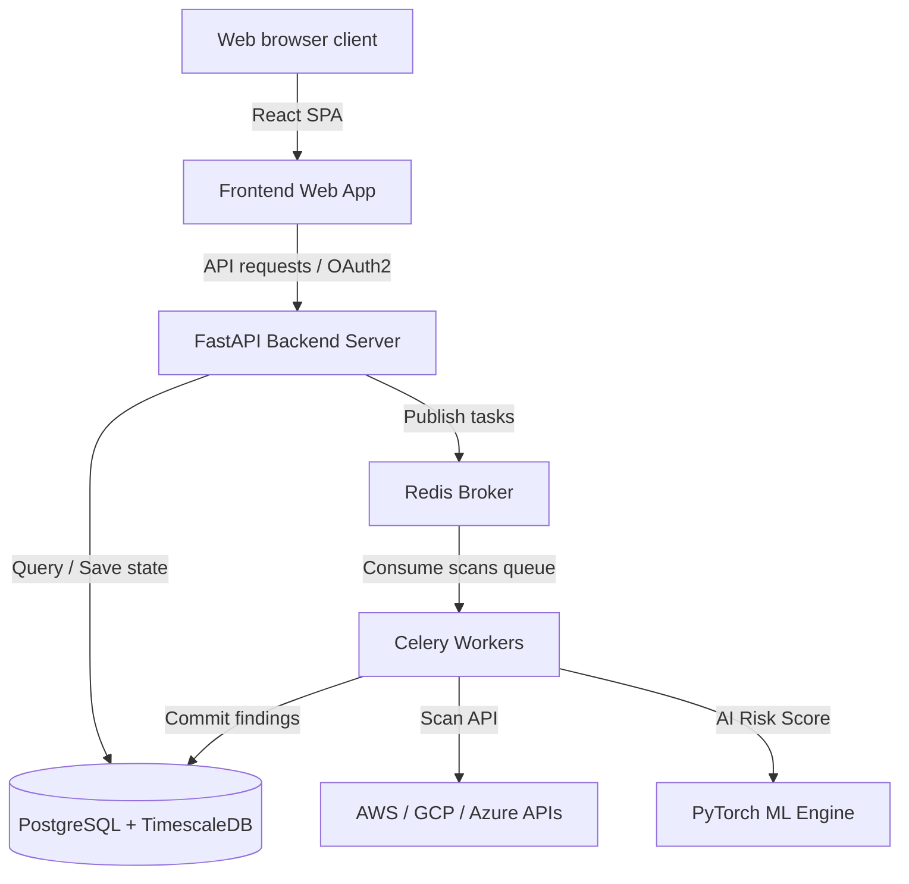

# SecureFlow - AI-Powered Cloud Security Posture Management (CSPM)

SecureFlow is a local cloud-security research prototype. It includes AWS listing/check workflows, explicit sample-data demos and review-only Terraform plans. It is not production-ready or a complete cloud compliance audit. No automatic cloud repairs are verified. Credential storage and policy/region coverage still need hardening.

---

## 🏗️ System Architecture



---

## 📂 Project Structure

```
secureflow/
├── backend/
│   ├── app/
│   │   ├── api/             # Auth, Scans, Vulnerabilities routers
│   │   ├── config/          # Settings schema & DB pooling connections
│   │   ├── core/            # JWT security, custom middleware, exceptions
│   │   ├── database/        # Declarative models for SQL Tables
│   │   ├── ml/              # PyTorch Neural Classifiers & training scripts
│   │   ├── scanners/        # Boto3 AWS (S3, EC2, IAM) scanning loops
│   │   ├── services/        # Logic handlers
│   │   ├── tasks/           # Asynchronous Celery workers
│   │   └── utils/           # JSON logger, metrics hooks
│   └── tests/               # Pytest verification suite
├── frontend/
│   ├── src/
│   │   ├── components/      # Dashboard, ScanList, VulnerabilityDetails
│   │   ├── services/        # Axios API handlers
│   │   └── App.tsx          # Material UI application base
│   └── index.html           # SPA template mount
├── scripts/
│   ├── seed_database.py     # Database configuration seeder
│   └── setup.sh             # Automated bootstrapping tool
├── docker-compose.yml       # Production-ready orchestration
└── README.md
```

---

## ⚡ Quick Start (Single-Command Setup)

To configure, compile, train the AI models, and run the database and dashboard locally:

1. **Bootstrap local setup script**:
   ```bash
   bash scripts/setup.sh
   ```

2. **Start the orchestrations container**:
   ```bash
   docker-compose up --build
   ```

3. **Verify services**:
   - Access **SecureFlow Web App**: [http://localhost:3000](http://localhost:3000)
   - Access **FastAPI API Swagger Docs**: [http://localhost:8000/api/docs](http://localhost:8000/api/docs)
   - Default login email: `admin@secureflow.io`
   - Default login password: `password123`

---

## 🧠 AI/ML Engine Models

Runtime review rules and separate model-development code have different roles:

- **Scanner severity at runtime**: Explicit CVSS threshold review rule (Critical, High, Medium, Low), no calibrated confidence or model explanation. Separate PyTorch severity-training code is retained for experiments, not used for scanner scoring.
- **Activity Anomaly Detector**: Separate autoencoder/Isolation Forest development code. Availability and validity of local trained artifacts must be checked; an output is not proof of privilege escalation or exfiltration.
- **NLP Threat Classifier**: Keyword rules or a locally trained TF-IDF backup by default. No BERT fine-tuning experiment is included or claimed. Optional transformer loading requires an explicitly enabled local checkpoint with normal/threat labels and complete weights.

## Production signing key guard

`DEBUG=False` requires a unique random `SECRET_KEY` of at least 32 characters.
The API refuses to start with its built-in demo key or a short/blank key.
Generate your own key locally (for example, `openssl rand -hex 32`); do not commit it.
This startup check does not make the application production-ready by itself.

Configuration-only regression tests (no cloud/database required):

```bash
cd backend
python -m unittest discover -s tests -p 'test_settings.py'
```

## Tenant ownership checks

Scan dispatch now requires an active cloud account belonging to the caller's
organization. Finding reads and remediation requests are also scoped through
the owning scan's organization. Worker lookups re-check the same organization
and account relationship. Cross-tenant and inactive accounts fail before task
dispatch. No database schema change is needed.

SQLite service regressions (cloud/Celery dispatch mocked):

```bash
cd backend
python -m unittest discover -s tests -p 'test_tenant_access.py'
```

These tests do not execute cloud scans or Terraform. Existing remediation status
semantics and demo-scan behavior still need separate review; an accepted request
must not be described as a verified cloud repair.

### Remediation plans are not cloud repairs

The review-plan endpoint stores a PENDING Terraform template. It does not run
Terraform, set an execution timestamp, or close the finding. A missing template
is rejected. Existing historical APPLIED/REMEDIATED rows are not rewritten by
this source change; their execution has not been independently verified.
Unexpected save failures return a fixed diagnostic: raw driver or database
exceptions (which can carry SQL parameters or secret-bearing URLs) never reach
the response body, and the route contract no longer describes saved plans as
executed repairs.

### Scan truthfulness checkpoint

AWS demo data is now an explicit connector choice (`credentials.scan_mode =
"demo"`). Missing credentials, client setup errors and provider read failures
never switch a real AWS scan into a simulated success. Demo findings carry a
`[DEMO]` title and synthetic evidence, and the scan ends as `DEMO_COMPLETED`.
Other providers are not wired into the worker, so new non-AWS scans are rejected.
Existing stored rows have not been relabeled or migrated.

A failed resource check fails the run rather than reporting an unverified clean
result. A completed run covers only the implemented checks. Pagination,
region/account-wide coverage and policy-condition interpretation still need
review; this is not a complete compliance audit. New real AWS credentials are stored in authenticated encrypted envelopes when
a separate storage key is configured. Legacy plaintext rows are rejected by
scan dispatch and require a deliberate secure re-registration plan. No existing
rows have been migrated. Do not connect production credentials before an
isolated end-to-end review and key-management setup. No cloud scans or repairs were performed during this change.

The broker failure path no longer creates an untracked local thread. An ambiguous
queue failure leaves a failed scan record; inspect it before retrying. Findings
receive per-run database IDs so a later scan cannot move an earlier scan's
findings. Alert records now claim only the in-app channel actually implemented,
not external Slack delivery.

### Interrupted scan recovery

Scan rows record when their current RUNNING ownership began. A soft task limit
of 29 minutes gives a stalled worker the chance to save a failed state before
the 30-minute hard kill, and a periodic sweeper marks RUNNING scans whose claim
is older than 35 minutes as FAILED, which makes them visible and reclaimable by
a later delivery. A scan a live worker may still own is never touched, and no
finding rows can exist for an interrupted run because findings commit in the
same transaction as the final status. Rows claimed before this tracking existed
fall back to their creation time. Existing databases need the new `started_at`
column added before rollout; `create_all` does not alter existing tables. The
sweeper acts only while a Celery Beat scheduler runs alongside the workers.
Recovery marks interrupted scans failed; it does not replay them, so re-dispatch
deliberately after checking effects.

Regression checks (synthetic SDK clients and SQLite, no cloud calls):

```sh
cd backend
python -m unittest discover -s tests -v
cd ../frontend
npm run build
```

Optional UI checks use Playwright Core and a local Chrome installation. Install
it in a separate test workspace, start the frontend at port 8767, then set
`NODE_PATH` to that workspace's `node_modules` and run
`node tests/demo-modes.cjs`. `BASE_URL`, `CHROME_BIN` and `SCREENSHOT_DIR` can
override the defaults. All API replies in this check are synthetic; it verifies
the demo payload, disabled secret fields, status labels and mobile overflow, not
an actual AWS scan.

### AWS pagination checkpoint

The implemented S3 bucket, EC2 instance, IAM user/MFA/access-key, RDS instance,
Lambda function, VPC and VPC flow-log listings now follow their SDK continuation
tokens. Repeated or missing continuation tokens, a 1,000-page limit, and errors
on later pages fail the run instead of publishing a partial clean result. Tests
use synthetic clients and botocore Stubber only, with no AWS requests. CloudTrail
`describe_trails` has no pagination token; it remains the existing regional
check. This does not add account/region discovery, organization-wide coverage,
full policy interpretation or every AWS service. Database credentials remain
unencrypted at application level. No claim of a complete compliance audit.

### Threat-model safety checkpoint

A base BERT checkpoint can initialize a random classification head. This must not
be treated as trained security inference. Default startup no longer loads or
downloads that base model. `ENABLE_THREAT_MODEL=true` and `THREAT_MODEL_PATH`
opt in to an already-local reviewed checkpoint with exactly `{0: "normal",
1: "threat"}` labels and no missing/mismatched weights. These guards do not prove
training quality or calibration. Log responses include `method` and
`calibrated: false`; rule confidence values are heuristic, not measured accuracy.
Only load locally trusted model/pickle artifacts; this is not an artifact sandbox.

Offline model-load regressions: `python -m unittest discover -s tests -p
 'test_threat_model_safety.py' -v` from backend (numpy required). No model download
or cloud action is part of those tests.

### Encrypted connector storage (source-only checkpoint)

New real AWS connectors require `CLOUD_CREDENTIALS_KEY`, a base64-encoded random
32-byte key, shared by API and workers and kept separately from the database.
There is no default, auto-generated fallback or plaintext write path. AES-256-GCM
authenticates the account ID, tenant ID and provider alongside the ciphertext,
so moving an envelope between accounts/tenants/providers fails verification.
Demo profiles discard all supplied keys and still work without this setting.
List/register responses never return secrets or ciphertext. Queue messages
contain only IDs, not decrypted credentials. Decryption happens just before
validation/worker use. Credentials still exist briefly in service memory and
are submitted to AWS if a real scan is separately started.

This does NOT migrate old plaintext rows, configure a deployment, rotate keys
or clear old backups. Legacy rows are intentionally blocked before queueing.
Existing operators must back up and retain their current keys, plan rotation
and secure re-registration, and review historical database/backups separately.
Do not paste keys into tickets/chat, commit them or reuse the JWT signing key.
Losing/changing the storage key makes existing envelopes unreadable. A KMS or
managed-secret integration, rotation tooling and live staging verification are
still future work. No production credential or database was touched here.

Run `python -m unittest discover -s tests -v` from `backend`. Tests use disposable
keys, synthetic credentials, SQLite and mocked scanners/dispatch only.


### Scan delivery idempotency checkpoint

Workers atomically claim only PENDING/FAILED scans and clear stale completion
metadata. Already-completed deliveries do not rescan or create duplicate results;
a RUNNING scan is not taken over by a second delivery. Three additional isolated
SQLite tests cover those boundaries. Interrupted RUNNING scans are recovered by
the sweeper described in "Interrupted scan recovery" below. This is still not a
complete broker exactly-once protocol, and distributed PostgreSQL/Celery
concurrency still needs staging validation.


### Ambiguous scan dispatch

A broker publish exception no longer marks a scan FAILED: acceptance may already
have happened, and a fast worker may already be RUNNING or completed. The API
returns503 with QUEUE_ACCEPTANCE_UNKNOWN and the owned scan ID, preserving the
record for status inspection instead of spawning a fallback or dispatching again.
Synthetic service/route tests cover a lost publish response after completion.
This does not prove broker acceptance or implement a durable outbox; PENDING
records after ambiguity still need operator reconciliation before retrying.


### Severity output provenance

Scanner severity now uses an explicit CVSS threshold review rule. The service no
longer supplies fabricated exploitability, impact, age, previous-vulnerability,
framework or region features to a model, and no longer presents static weights
as model feature importance. Response evidence names the rule, has no confidence
estimate, marks calibration false and leaves unavailable explanations empty.
Two isolated regressions cover thresholds and invalid scores. These are not
verified exploitability predictions or proof of a security incident. The separate
model-training code is retained but is not used to override scanner severity.


### Unavailable anomaly detection

The metric-analysis service returns an explicit unavailable/error response when
local detector artifacts are absent, not a fabricated normal score of0.02. Inputs
must have eight finite values and detector outputs must be finite before being
returned. Two isolated tests cover availability and numeric boundaries. Valid
output remains uncalibrated and is not a verified incident assessment.


### Explicit database selection

The backend honors `DATABASE_URL` without a startup network probe or automatic
SQLite substitution. A configured PostgreSQL outage must surface as a database
error, not an apparently empty workspace in a different local database. For an
intentional local SQLite demo, set `DATABASE_URL=sqlite:///./secureflow.db`
explicitly. Three isolated configuration tests stub engine creation; they do not
verify a live PostgreSQL server or apply migrations.

### Readiness and API contract checkpoint

The readiness probe now runs its database check with SQLAlchemy 2.0 textual SQL
and answers 200 only when the database actually responds. A failed probe returns
a fixed "not ready" body and log line: driver errors, which can carry the
database user, host or DSN, stay out of both because the probe is
unauthenticated. The API description no longer advertises "AI-powered"
management; it describes the prototype as it is. Health/readiness behavior is
covered by isolated tests with a synthetic broken database; no live database was
used.
